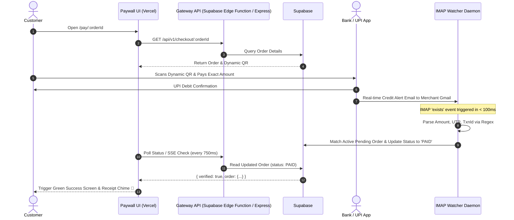

<div align="center">

# ⚡ ArchXpay • Automated UPI Payment Gateway

**An open-source UPI checkout prototype with dynamic QR generation and Gmail alert-based payment matching.**

[](https://opensource.org/licenses/MIT)
[](https://nodejs.org/)
[](https://expressjs.com/)
[](https://supabase.com/)
[](https://vercel.com/)

[Live Demo](https://public-zeta-cyan-79.vercel.app) • [Architecture](#-architecture--lifecycle) • [Quick Start](#-quick-start) • [API Reference](#-api-reference) • [Deployment](#-cloud-deployment)

---

</div>

## 📖 Overview

ArchXpay is a merchant-gateway platform that creates UPI payment requests, applies administrator approval, and uses configured Gmail alerts for order verification.

* **Merchant onboarding**: Google sign-in, merchant application, manual review, and approved-only API access.
* **Developer portal**: Merchant metrics, API credentials, integration examples, and order history.
* **Super-admin console**: Application and staff management, permission sets, audit events, feature flags, and maintenance mode.
* **Checkout tools**: Dynamic QR requests and collision-reducing amount allocation.

> **Important:** UPI QR requests and Gmail alert matching are not equivalent to bank-authoritative payment webhooks or regulated payment processing. Email delivery and verification timing are provider-dependent. Confirm applicable legal, banking, privacy, and security requirements before handling real payments.

## Merchant review and roles

Users authenticate with Google through Supabase Auth. New merchants submit their phone number, business/payee details, UPI ID, target app/site and website URL, and Gmail IMAP configuration. Applications remain pending until an administrator marks them under review, approves, or denies them. Only approved applications receive a live API key. The account `shashanksv2009@gmail.com` is bootstrapped as super admin by the database migration; regular admins receive explicit permissions.

---

## 🏗️ Architecture & Lifecycle

The sequence below illustrates the real-time payment verification flow:



---

## ✨ Key Features

### 1. 🛡️ Mathematical Anti-Collision Engine
When multiple users initiate checkouts for identical amounts at the same moment, traditional UPI P2P gateways cannot distinguish which user paid. ArchXpay solves this through dynamic **Micro-Paise Concurrency Slots**:
* **User 1**: Allocated ₹1.00 (`tr=PAY111`)
* **User 2**: Allocated ₹1.01 (`tr=PAY222`)
* **User 3**: Allocated ₹1.02 (`tr=PAY333`)
When User 1 pays ₹1.00, only User 1 receives verification. User 2's screen remains strictly in `PENDING` status until User 2's distinct payment of ₹1.01 arrives.

### 2. ⚡ Lightning-Fast Auto-Verification (< 1s)
* **UID Memoization**: Skips re-parsing older messages; only downloads the single newly arrived message stream.
* **IMAP IDLE Push**: Reacts immediately to TCP socket `exists` notifications emitted by Gmail.
* **Active Visibility Listener**: Browser automatically triggers an immediate zero-delay verification query the instant a user switches back from their UPI app.

### 3. 📱 Minimalist Dynamic Paywall & 1-Tap Mobile Intent
* **Dynamic QR Code**: Rendered via vector canvas with high error correction (`H`) and exact micro-paise amounts pre-filled.
* **1-Tap Mobile Intent Deep-Linking**:
  * **Direct UPI Intent & FamPay**: Standard universal system app selector (`upi://pay?...`).
  * **Google Pay**: Uses registered Tez scheme (`tez://upi/pay?...`).
  * **PhonePe**: Targeted deep-link (`phonepe://pay?...`).
  * **Paytm**: Package-targeted Android Intent (`intent://pay?...#Intent;scheme=upi;package=net.one97.paytm;end`) with `paytmmp://` iOS fallback.
  * **Navi & super.money**: Explicit Android package deep-links.
* **Strict NPCI Compliance**: Keeps the `@` symbol unencoded in the VPA (`pa=handle@fam` instead of `%40`) and appends `mode=00` to prevent bank app rejection.
* **Zero-Delay Status Radar**: Instant auto-polling (< 750ms) + visibility listener when switching back from UPI apps.

---

## 📁 Repository Structure

```
├── .env.example                # Environment variables template
├── package.json                # Project dependencies and npm scripts
├── server.js                   # Express master server & local runtime
├── vercel.json                 # Vercel deployment & API rewrites configuration
├── data/                       # Local data directory
├── public/                     # Frontend client assets
│   ├── app.js                  # Merchant onboarding & dashboard logic
│   ├── index.html              # Landing page & merchant dashboard
│   ├── js/
│   │   └── checkout.js         # Mobile UPI deep-linking & intent builder
│   ├── paywall.css             # Paywall styling & laser scanner animation
│   ├── paywall.html            # Hosted customer checkout screen with 1-tap intent
│   ├── paywall.js              # Real-time polling & success handler
│   └── style.css               # Global application stylesheet
├── services/
│   ├── concurrencyWatcher.js   # IMAP daemon & real-time matching engine
│   ├── emailMonitor.js         # Fallback periodic email reader
│   ├── supabase.js             # Supabase connection & persistence helpers
│   ├── paymentParser.js        # Bank alert regex extractor (UTR, Amount)
│   ├── qrHelper.js             # Dynamic NPCI UPI URI & QR generator
│   └── store.js                # Dual local & Supabase persistence layer
├── supabase/
│   ├── config.toml             # Supabase local and function settings
│   ├── functions/
│   │   └── payment-gateway/
│   │       └── index.ts        # Supabase Edge API
│   └── migrations/             # Database schema migrations
├── src/
│   └── utils/
│       └── qr.util.js          # Core NPCI URI builder & QR generator
└── uploads/                    # Merchant QR codes & media uploads
```

---

## 🚀 Quick Start

### Prerequisites
* **Node.js**: v22.0.0 or higher
* **Supabase**: A project linked with the CLI and all migrations in [`supabase/migrations/`](./supabase/migrations/) applied
* **Google Auth**: Google provider enabled in Supabase Auth with valid redirect URLs
* **Gmail Account**: Each merchant uses a dedicated Gmail [App Password](https://myaccount.google.com/apppasswords) (requires 2-Step Verification)

### 1. Clone the Repository
```bash
git clone https://github.com/admintncnursing-gif/automated-payment-gateway.git
cd automated-payment-gateway
```

### 2. Install Dependencies
```bash
npm install
```

### 3. Configure Environment Variables
Copy `.env.example` to `.env`:
```bash
cp .env.example .env
```
Fill in your configuration:
```env
PORT=3000
SUPABASE_URL="https://your-project-id.supabase.co"
SUPABASE_ANON_KEY="your-supabase-anon-key"
SUPABASE_SERVICE_ROLE_KEY="your-supabase-service-role-key"
```

Apply the migrations in `supabase/migrations/`, enable Google as a provider in Supabase Auth, and add your local/deployed site URL to Supabase's allowed redirect URLs. Merchant Gmail App Passwords are entered in the dashboard application and stored encrypted; do not configure a global Gmail password.

The migration promotes `shashanksv2009@gmail.com` to super admin when that Google account signs in. Treat the service-role key as a server secret only. The `.env.example` value was removed; rotate any key that was previously shared or committed.

### 4. Start the Server
```bash
# Start production server
npm start

# Or start in watch mode for development
npm run dev
```

Visit `http://localhost:3000` to access the Merchant Portal. Sign in with Google and submit a merchant application; payment APIs stay disabled until an admin approves it.

---

## 🌐 Deployment

### Cloudflare

The Cloudflare deployment command is:

```bash
npx wrangler deploy
```

Set `SUPABASE_URL` and `SUPABASE_ANON_KEY` as Cloudflare Worker variables. Do not put `SUPABASE_SERVICE_ROLE_KEY` in Cloudflare variables or browser code.

Cloudflare static assets can display the ArchXpay interface, but checkout creation, administrator APIs, and persistent Gmail IMAP verification require the Express Node server. Deploy that server on a persistent host and keep `SUPABASE_SERVICE_ROLE_KEY` available only there.

The merchant portal, approval workflow, and IMAP watcher require the Express server. Deploy the full repository to a persistent Node.js host (for example, a VPS, Railway, or Render) rather than deploying only `public/` as a static site. Configure the environment variables above on that server and run:

```bash
npm ci
npm start
```

Keep the Node service and its Gmail credential encryption key available continuously. Set Supabase Auth's site URL and redirect allowlist to the deployed origin. Do not expose the Supabase service-role key in the browser or a static build.

The optional Supabase Edge Function provides public checkout endpoints, not the authenticated merchant/admin portal. To use it independently:
```bash
npx supabase login
npx supabase link --project-ref your-project-id
npx supabase db push
npx supabase functions deploy payment-gateway --no-verify-jwt
```
The CLI asks for a Supabase personal access token for local project management. The Edge Function uses Supabase's server-side secret; never place it in a static frontend.

---

## 📡 API Reference

### 1. Create Dynamic Order
Generates a unique dynamic order with anti-collision amount and dynamic QR code.

* **Endpoint**: `POST /api/v1/checkout/create`
* **Headers**: `x-api-key: <approved-merchant-api-key>`, `Content-Type: application/json`

**Request Body:**
```json
{
  "amount": 10.00,
  "customerName": "John Doe",
  "customerEmail": "john@example.com",
  "note": "Pro Subscription"
}
```

**Response (201 Created):**
```json
{
  "success": true,
  "orderId": "PAY-898968-338",
  "amount": 10.00,
  "currency": "INR",
  "status": "PENDING",
  "checkoutUrl": "https://your-gateway.example/pay/PAY-898968-338",
  "dynamicUpiUrl": "upi://pay?pa=yourupi@fam&pn=Your%20Business&am=10.00&cu=INR&tn=PAY898968338&tr=PAY898968338",
  "dynamicQrDataUrl": "data:image/png;base64,iVBORw..."
}
```

---

### 2. Check Order Status
Real-time endpoint called by the checkout paywall to detect verified payments.

* **Endpoint**: `GET /api/v1/checkout/status/:orderId`

**Response (200 OK):**
```json
{
  "success": true,
  "verified": true,
  "order": {
    "orderId": "PAY-898968-338",
    "amount": 10.00,
    "status": "PAID",
    "verifiedAt": "2026-11-16T14:20:24.260Z",
    "paymentDetails": {
      "amount": 10.00,
      "utr": "668612930011",
      "txnId": "FMPIB7007283579",
      "senderName": "Customer"
    }
  }
}
```

---

### 3. Manual UTR Verification
Lets a customer submit their bank reference number for an exact match against the merchant's parsed Gmail payment alerts. A customer-provided reference alone never marks an order paid. This verification path requires the persistent Node server and configured Gmail IMAP watcher; the optional Edge Function cannot independently verify UTRs.

* **Endpoint**: `POST /api/v1/checkout/verify-utr`
* **Headers**: `Content-Type: application/json`

**Request Body:**
```json
{
  "orderId": "PAY-898968-338",
  "utr": "668612930011"
}
```

**Response (200 OK):**
```json
{
  "success": true,
  "verified": true,
  "order": {
    "orderId": "PAY-898968-338",
    "status": "PAID"
  }
}
```

---

## 🔒 Security Best Practices

1. **Never commit `.env` or credentials**: Ensure `.env` and `data/store.json` remain in your `.gitignore`.
2. **App Passwords**: Never use your primary Google account password; always use a dedicated Gmail 16-character App Password.
3. **Database Rules**: Keep the Supabase service-role key server-side only; row-level security is enabled on the application tables.

---

## 🤝 Contributing

Contributions are welcomed! Follow these steps:
1. Fork the Project
2. Create your Feature Branch (`git checkout -b feature/AmazingFeature`)
3. Commit your Changes (`git commit -m 'Add some AmazingFeature'`)
4. Push to the Branch (`git push origin feature/AmazingFeature`)
5. Open a Pull Request

---

## 📄 License

Distributed under the **MIT License**. See [`LICENSE`](LICENSE) for more information.

---

<div align="center">
  <sub>Platform <a href="https://www.kira-devs.xyz/" target="_blank" rel="noopener noreferrer">Terms &amp; Information</a></sub>
</div>
